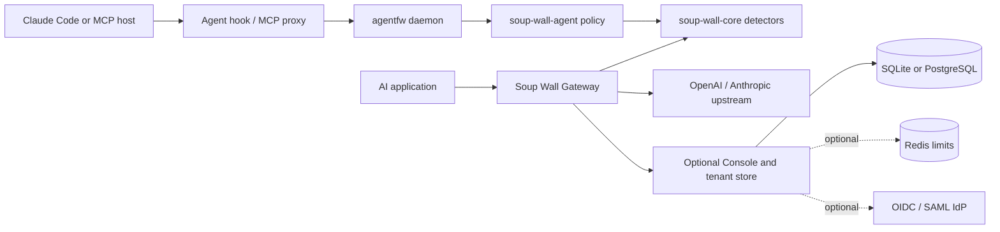

# Soup Wall architecture

Soup Wall has two enforcement paths and one optional self-hosted control plane. The paths share detection and policy code, but they do not require a Soup Wall service or account.



## Source map

| Directory | Responsibility |
| --- | --- |
| `crates/core` | Detection, normalization, findings, scoring, text policy and masking |
| `crates/agent` | Agent events, taint, action class, egress, authority and decision policy |
| `crates/agentfw` | Local daemon, Claude Code hooks, MCP proxy, grants, audit and guarded execution |
| `crates/proxy` | HTTP data plane for Chat Completions, Responses and Messages, plus the self-hosted Console and tenant store |
| `crates/adapter` | Versioned local decision and audit types for future integrations |
| `crates/bench` | Reproducible regression corpora and policy gates |
| `policies` | Built-in text policy; the agent default is under `crates/agent/policies` |
| `deploy` | Container, Compose, Kubernetes and edge examples |

The Gateway and Console currently live in one `crates/proxy` package. A local Gateway can run without a tenant store; enabling `tenant_store` adds the Console, tenant authentication and optional identity services. This is a configuration boundary today. Splitting the package for a smaller local install is a future refactor, not a prerequisite for accessing any source.

## Decision boundaries

The Agent computes verdicts for tool actions and records them locally. Its default is shadow mode. The Claude Code hook depends on host behavior and fails open when the daemon is unavailable. The guarded execution commands own process creation and fail closed. See [SECURITY.md](../SECURITY.md) before treating a hook verdict as an execution boundary.

The legacy MCP proxy checks manifests. Opt-in [stdio MCP admission](operations/MCP_STDIO_ADMISSION.md)
uses the reviewed native registry to gate supported calls before server execution
and original text results before release to the MCP host. It fails closed and
supports a bounded sequential contract; host release is not attestation of
the host's later model-context serialization.

The Gateway inspects request and response traffic and applies its text policy. Agent inspection and capability policy in the Gateway are separate opt-in controls. A provider request deliberately leaves the host for the configured upstream. With the Console enabled, audit and usage data can also be written to the configured local or external store.

The Console does not currently distribute Agent policy automatically. `soup-wall-adapter` defines a versioned contract for that integration, and the [roadmap](ROADMAP.md) tracks the work. Keep Agent and Gateway policies explicit until a tested rollout path exists.

## Incomplete session provenance

The [taint tracker](../crates/agent/src/taint.rs) retains at most `cap`
fingerprint entries and `cap` distinctive URL/path entries per active session,
with independently bounded FIFO queues. Eviction from either index sets a
sticky `incomplete` boolean. With `cap = 0`, any recorded untrusted input sets
it immediately, including input too short to fingerprint. Trusted input does
not set or clear it. This marker adds one boolean per session, with no discarded
text, fabricated source, eviction list or growing counter. Existing retained
literal/provenance string sizes and the number of active sessions are not a
global byte bound; hosts must bound input sizes and close ended sessions.

`TaintTracker::is_incomplete`, `AgentFirewall::provenance_incomplete`,
`Signals::provenance_incomplete` and `Outcome::provenance_incomplete` expose
the state. `check()` still reports only retained, matching evidence; `None`
does not establish clean provenance. `is_empty()` is false while history is
incomplete, even with zero retained entries. This does not claim perfect
provenance below capacity: existing extraction/fingerprint limits remain.

After ordinary policy evaluation, incomplete history imposes an **Ask floor**
on tool calls classified at least `SideEffecting` (including Network,
PrivilegeChanging and Destructive) or touching a sensitive path, even if
classified ReadOnly. Allow and Escalate become Ask, with no judge fallback and
reason `taint-history-incomplete`; an existing Ask or hard Deny keeps its
original verdict and reason. A retained mark can still trigger a stronger Deny.
The floor applies to both normal and native inspection, including custom Allow
policies. It does not synthesize a taint source for discarded evidence. Ordinary
nonsensitive ReadOnly calls and unrelated sessions keep their policy behavior.

An Ask is not an execution grant: consumers retain their existing confirmation
and enforcement requirements. Confirming one action does not clear the marker.
Native result preview does not record withheld content; admitting an untrusted
result does. A repeated SessionStart on the same active session does not reset
history. SessionEnd deletes that session's evidence and marker; a new session
starts empty. A safe reset requires the host to discard the old model context,
pending calls and derived plans before ending it and starting a fresh session.
Renaming a session, restarting a daemon or emitting SessionEnd while reusing the
old context is not a safe reset. This component cannot attest host context disposal.

### Focused reproduction

```sh
cargo test --locked -p soup-wall-agent incomplete_marker -- --nocapture
cargo test --locked -p soup-wall-agent zero_capacity_marks -- --nocapture
cargo test --locked -p soup-wall-agent --test provenance_overflow -- --nocapture
cargo test --locked -p soup-wall-agent
```

The [synthetic regressions](../crates/agent/tests/provenance_overflow.rs) cover
early prose/URL/path reuse after eviction, zero capacity, benign below-capacity
work, unaffected peer sessions, trusted input, duplicate starts, end/new-session
behavior, withheld/admitted native results and hard-Deny/judge precedence.
Tracker unit tests assert both map and queue bounds through repeated overflow.
These are component checks, not certification of the complete Phase 2 runtime.
The existing CI test job retains the focused test log as an artifact.

## Frozen policy composition

The production contract has three stages: derive signals in `AgentFirewall`,
evaluate the operator's first matching YAML rule (or default), and apply required
safety floors before final resolution. The YAML schema and rule order are unchanged.
Later arbitrary operator rules are not scanned for a stronger verdict. Required
hard refusals reuse the shipped policy's Deny predicates, independently of an
earlier custom Allow/Ask/Escalate. A selected Deny retains its original reason.

| Evidence | Required result / precedence |
| --- | --- |
| Retained untrusted taint + destructive or privilege-changing action | Deny |
| Delegated tool outside its registered grant, or spawn beyond parent's grant | Deny |
| Secret finding in tool arguments + Network or more severe action | Deny |
| Incomplete provenance + protected action | Ask floor, below every Deny |
| PII egress, sensitive-path egress, unknown destination, manifest drift/shadow | Shipped Ask rules precede taint escalation; operator YAML remains configurable |
| Taint alone + ordinary side effect | Shipped Escalate with explicit Allow fallback |
| Ordinary nonsensitive read, known benign destination | Existing benign behavior |

An `egress_not_allowlisted: false` condition requires a nonempty destination list
whose every host is allowlisted. Missing destinations cannot satisfy positive
allowlist evidence. Extraction completeness and enforceable resource grants remain
the selected executor's responsibility; a library Allow is not a resource grant.
This increment does not change native/MCP admission wiring or resource contracts.

Delegation is recorded only after the spawn's production policy returns Allow.
Ask, Deny and unresolved Escalate do not register proposed child rights. Calls
carrying a parent identity must hold their registered tool grant. Root registration
and authenticated parent/agent identity remain host responsibilities; callers must
not erase the parent field or reuse stale identity to bypass delegated checks.
Existing session cleanup and isolation apply. No approval-grant format changes.

### Judge and final decision contract

`soup_wall_agent::resolution::resolve` is used by adapter projection, hook decision
mapping and the existing handler escalation resolver. Concrete Allow/Ask/Deny
decisions are preserved. For Escalate:

| Fallback | Documentation, disabled/no judge, invalid reply, timeout/error/unavailable | Injection |
| --- | --- | --- |
| Allow | Allow | Ask |
| Ask | Ask | Ask |
| Deny (defensive API input; YAML still rejects it) | Deny | Deny |
| Missing or recursive Escalate | Ask | Ask |

The empty-span path uses this same resolver without contacting a model. An
unresolved Escalate reaching the hook boundary requires Ask rather than defer.
Hook Allow still maps to defer, preserving the operator's permission flow; shadow
mode still does not enforce. Native judge configuration remains unsupported: this
does not enable a provider, add paid calls or alter native wiring.

### Executable matrix and evidence

Run from the repository root with Git, Python and Cargo available:

```sh
python scripts/verify_policy_composition.py
```

The [frozen matrix](../crates/agentfw/tests/fixtures/policy_matrix_v1.json) contains
controlled signal overlaps, actual engine event sequences, handshake and native
library calls, and judge/final-boundary cases. The
[driver](../crates/agentfw/examples/policy_matrix.rs) invokes production APIs; it
does not implement replacement policy logic. The command also runs existing Agent
and daemon unit suites, loopback mock judge endpoint tests, native escalation
regressions, and the unchanged shipped agent-session corpus. Mock endpoint tests
exercise real invalid responses, HTTP errors, disabled judges and timeout behavior;
the matrix's failure labels alone do not simulate transport.

`target/policy-composition/` contains expected/actual rows, command exits and logs,
HEAD/tree, dirty state, per-source-file hashes, a combined source digest and separate
policy/input SHA256 hashes. CI retains this directory as `policy-composition`.
CI checkout may be a PR merge commit; use the recorded SHA, not a branch label.
Tracked local edits are covered by content hashes; commit new files before recording
delivery evidence. A failing command makes the report fail and its log is retained.

Historical fixtures and corpus labels are preserved. New rows explicitly record
the former missing-fallback Allow, unresolved-hook defer, softened Deny, ignored
false destination condition and premature child registration. Two unit assertions
for the old unsafe fallback/boundary behavior change alongside the production fix;
these are documented defect corrections, not relabelled evaluation corpus entries.
The former judge transport test's credential-path call now meets a mandatory hard
Deny and is retained verbatim as `historical-judge-credential-overlap`. Transport
tests use an ordinary report file to continue exercising actual judge responses;
their fallback expectations are unchanged. The initial failing CI evidence remains
in PR history. No shipped corpus input or label is changed.
The matrix is a synthetic component contract, not held-out accuracy or full runtime
effectiveness acceptance. Independent integration acceptance remains separate.

## Where to work next

Add a detector in `crates/core`, an agent decision rule in `crates/agent`, or a provider adapter in `crates/proxy`. For every enforcement change, add a test for the unsafe action and a benign case that should still succeed. Run the [full workspace checks](../CONTRIBUTING.md) and the relevant policy regression corpus before changing a default.

The report also replays the unchanged 40-session corpus with the historical
negative-control policy `agent_policies: []; default: allow` (valid YAML is
written to the evidence directory). Mandatory production Deny floors now stop
13 attacks that this policy formerly missed; its six remaining misses are
retained by session ID in `negative-control.json`. The control must exit 1 and
fail the policy gate, with zero benign interruptions. The report verifies this
specific failure; it does not suppress arbitrary command failures or relabel
any corpus expectations. The report unit tests retain the same input and now
assert six misses under the production floors instead of the historical 19.
